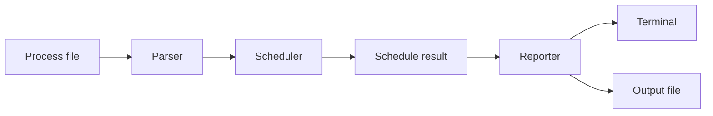

<p align="center">
  
</p>

<p align="center">
  <a href="https://github.com/MerveilleDivine/OS_project_scheduler/actions/workflows/cpp-ci.yml">
    
  </a>
</p>

# CPU Scheduler Simulator

A C++ command-line simulator for exploring how CPU scheduling decisions change waiting time, turnaround time, and response time.

Give it one process file and an algorithm, and it produces the execution order, per-process metrics, averages, and a Gantt-style timeline. Comparison mode runs the same workload through several schedulers so their trade-offs are visible side by side.

## Why this project matters

This began as an Operating Systems course assignment. The first version worked, but most of the logic lived in one file.

I returned to it later and rebuilt the project around clearer responsibilities:

- parsing is separate from scheduling;
- scheduling is separate from reporting;
- behaviour is protected by CLI regression tests;
- the project builds through both `g++` and CMake;
- every push and pull request is checked by GitHub Actions.

The algorithms are the subject of the project. The refactor is the better demonstration of how I engineer now.

## Algorithms

| Algorithm | Scheduling model | Selection rule |
|---|---|---|
| **FCFS** | Non-preemptive | Earliest arriving process runs first |
| **SJF** | Non-preemptive | Shortest available burst runs first |
| **Priority** | Non-preemptive | Lowest priority number runs first |
| **Round Robin** | Preemptive | Ready processes share the CPU using a time quantum |
| **None** | Sequential | Processes run in file order |

## Comparison result

Using the included sample workload and a Round Robin quantum of `2`:

| Algorithm | Avg. waiting | Avg. turnaround | Avg. response |
|---|---:|---:|---:|
| FCFS | 7.00 ms | 11.00 ms | 7.00 ms |
| SJF | 6.40 ms | 10.20 ms | 6.40 ms |
| Priority | 6.40 ms | 10.20 ms | 6.40 ms |
| Round Robin | 11.40 ms | 15.20 ms | 3.00 ms |

Round Robin responds sooner in this workload, but increases average waiting and turnaround time. The simulator is meant to expose that kind of trade-off rather than declare one universal winner.

## Architecture



| Component | Responsibility |
|---|---|
| `Parser` | Reads and validates process data |
| `Scheduler` | Implements each scheduling strategy |
| `Reporter` | Formats metrics, comparisons, and the timeline |
| `main.cpp` | Parses CLI arguments and coordinates the workflow |
| `tests/` | Exercises algorithms, errors, comparison mode, and file output |

## Quick start

### Build with CMake

```bash
cmake -S . -B build
cmake --build build
ctest --test-dir build --output-on-failure
```

The executable is created at `build/scheduler`.

### Or compile directly

```bash
g++ -std=c++11 src/main.cpp src/Parser.cpp src/Scheduler.cpp src/Reporter.cpp -Iinclude -o scheduler
```

## Usage

The examples below use the directly compiled `./scheduler` binary. If you built with CMake, use `./build/scheduler` on Linux and macOS or the corresponding executable path produced by your generator.

Run one algorithm:

```bash
./scheduler -f examples/sample_input.txt --algorithm fcfs
```

Run Round Robin:

```bash
./scheduler -f examples/sample_input.txt --algorithm rr --quantum 2
```

Compare the implemented schedulers:

```bash
./scheduler -f examples/sample_input.txt --compare --quantum 2
```

Write the report to a file:

```bash
./scheduler -f examples/sample_input.txt -o output.txt --algorithm priority
```

Supported algorithm values are `none`, `fcfs`, `sjf`, `priority`, and `rr`. Short and long CLI options are both accepted.

## Input format

Each line represents one process:

```text
burst_time:arrival_time:priority
```

The included sample is:

```text
5:0:3
4:1:2
3:1:1
4:2:2
3:3:1
```

In this implementation, a smaller priority number means a higher priority.

## Example output

```text
Scheduling Method: First Come, First Served
Process   Arrival   Burst   Priority   Start   Complete   Waiting   Turnaround   Response
P1        0         5       3          0       5          0         5            0
P2        1         4       2          5       9          4         8            4
P3        1         3       1          9       12         8         11           8
P4        2         4       2          12      16         10        14           10
P5        3         3       1          16      19         13        16           13

Average Waiting Time: 7.00 ms
Average Turnaround Time: 11.00 ms
Average Response Time: 7.00 ms

Gantt Chart:
| P1 | P2 | P3 | P4 | P5 |
0     5     9    12    16    19
```

## Verification

Run the regression suite directly:

```bash
bash tests/run_cli_tests.sh
```

The suite checks:

- FCFS, SJF, Priority, and Round Robin output;
- comparison mode;
- the generated Gantt chart;
- output-file generation;
- invalid Round Robin quantum handling.

GitHub Actions repeats the direct compiler build, regression suite, CMake build, and CTest run on Ubuntu.

## Repository map

```text
OS_project_scheduler/
├── .github/workflows/cpp-ci.yml
├── assets/readme-banner.svg
├── examples/sample_input.txt
├── include/
│   ├── Parser.h
│   ├── Process.h
│   ├── Reporter.h
│   └── Scheduler.h
├── src/
│   ├── main.cpp
│   ├── Parser.cpp
│   ├── Reporter.cpp
│   └── Scheduler.cpp
├── tests/run_cli_tests.sh
├── CMakeLists.txt
└── README.md
```

## Current scope

The simulator currently focuses on educational, single-core CPU scheduling. Preemptive SJF and preemptive Priority Scheduling are not implemented yet.

Possible next steps include exporting comparison data as CSV or JSON, improving the terminal timeline, and adding lower-level scheduler unit tests.

## Technology

`C++11` · `Operating Systems` · `CPU Scheduling` · `CMake` · `CTest` · `GitHub Actions`
