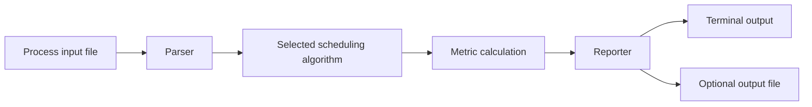

# CPU Scheduler Simulator


A C++ command-line simulator for running and comparing classic CPU scheduling algorithms.

It reads process data from a file, applies the selected scheduling strategy, and reports process-level timing metrics, averages, and a Gantt chart.

## At a glance

- **Algorithms:** FCFS, SJF, Priority Scheduling, and Round Robin
- **Outputs:** start, completion, waiting, turnaround, and response times
- **Modes:** individual algorithm runs and side-by-side comparison
- **Interface:** command-line input, file-based input, and optional output files
- **Quality:** CLI regression tests, CMake, CTest, and GitHub Actions CI

## Example result

```text
Scheduling Method: First Come, First Served
Process   Arrival   Burst   Priority   Start   Complete   Waiting   Turnaround   Response
P1        0         5       3          0       5          0         5            0
P2        1         4       2          5       9          4         8            4
P3        1         3       1          9       12         8         11           8
P4        2         4       2          12      16         10        14           10
P5        3         3       1          16      19         13        16           13

Average Waiting Time: 7.00 ms
Average Turnaround Time: 11.00 ms
Average Response Time: 7.00 ms

Gantt Chart:
| P1 | P2 | P3 | P4 | P5 |
0     5     9    12    16    19
```

## How it works



The program separates input parsing, scheduling logic, and reporting so that each responsibility can be tested and maintained independently.

## Scheduling algorithms

| Algorithm | Type | Behaviour |
|---|---|---|
| **FCFS** | Non-preemptive | Runs processes in arrival order |
| **SJF** | Non-preemptive | Selects the shortest available job |
| **Priority** | Non-preemptive | Selects the available process with the highest priority |
| **Round Robin** | Preemptive | Rotates through ready processes using a configurable time quantum |
| **None** | Sequential | Runs processes in their input order |

> Priority Scheduling treats a lower priority number as a higher priority.

## Comparison mode

Comparison mode runs the same process set through multiple algorithms and reports their average metrics together.

```bash
./scheduler -f examples/sample_input.txt --compare --quantum 2
```

Example:

| Algorithm | Avg. waiting | Avg. turnaround | Avg. response |
|---|---:|---:|---:|
| FCFS | 7.00 | 11.00 | 7.00 |
| SJF | 6.40 | 10.20 | 6.40 |
| Priority | 6.40 | 10.20 | 6.40 |
| Round Robin, quantum 2 | 11.40 | 15.20 | 3.00 |

These values come from the included sample input and are intended to illustrate the trade-offs between the algorithms rather than declare one universally best strategy.

## Input format

Each line contains:

```text
burst_time:arrival_time:priority
```

Example:

```text
5:0:3
4:1:2
3:1:1
4:2:2
3:3:1
```

A ready-to-use sample is available at `examples/sample_input.txt`.

## Build and run

### Compile with `g++`

```bash
g++ -std=c++11 src/main.cpp src/Parser.cpp src/Scheduler.cpp src/Reporter.cpp -Iinclude -o scheduler
```

### Build with CMake

```bash
cmake -S . -B build
cmake --build build
ctest --test-dir build --output-on-failure
```

### Run FCFS

```bash
./scheduler -f examples/sample_input.txt -o output.txt --algorithm fcfs
```

### Run Round Robin

```bash
./scheduler -f examples/sample_input.txt -o output.txt --algorithm rr --quantum 2
```

Supported values for `--algorithm`:

```text
none, fcfs, sjf, priority, rr
```

The longer CLI form is also supported:

```bash
./scheduler --input examples/sample_input.txt --output output.txt --algorithm sjf
```

## Project structure

```text
OS_project_scheduler/
├── include/
│   ├── Parser.h
│   ├── Process.h
│   ├── Reporter.h
│   └── Scheduler.h
├── src/
│   ├── main.cpp
│   ├── Parser.cpp
│   ├── Reporter.cpp
│   └── Scheduler.cpp
├── tests/
│   └── run_cli_tests.sh
├── examples/
│   └── sample_input.txt
├── .github/workflows/
│   └── cpp-ci.yml
├── CMakeLists.txt
└── README.md
```

| Component | Responsibility |
|---|---|
| `Parser` | Reads and validates process data |
| `Scheduler` | Applies the selected scheduling strategy |
| `Reporter` | Formats metrics, averages, and Gantt output |
| `main.cpp` | Parses CLI arguments and coordinates execution |
| `tests/` | Verifies expected CLI behaviour and output |

## Testing and CI

Run the regression tests locally with:

```bash
bash tests/run_cli_tests.sh
```

The test suite covers:

- FCFS
- SJF
- Priority Scheduling
- Round Robin
- comparison mode
- invalid Round Robin quantum handling
- output file generation

GitHub Actions verifies both supported build paths by compiling with `g++`, running the CLI tests, building with CMake, and running CTest.

## Refactor highlights

The project began as an Operating Systems course assignment and was later reworked into a cleaner engineering project.

The refactor:

- separated parsing, scheduling, reporting, and CLI responsibilities
- replaced the original single-file structure with dedicated source and header files
- added side-by-side algorithm comparison
- added regression tests to protect scheduling correctness
- added CMake and CTest support
- added GitHub Actions CI

## Tech and concepts

`C++11` `Operating Systems` `CPU Scheduling` `Queues` `File I/O` `CLI Design` `Regression Testing` `CMake` `GitHub Actions`

## Roadmap

- add preemptive SJF and Priority Scheduling
- export comparison results as CSV or JSON
- improve the Gantt chart visualisation
- add lower-level unit tests for scheduler functions

## License

MIT License.