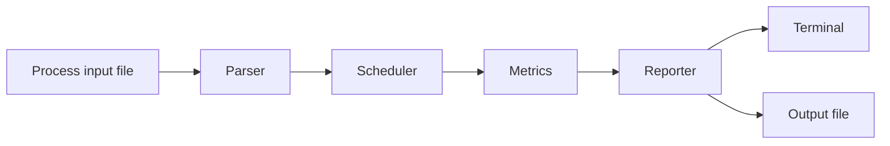

# CPU Scheduler Simulator


A small C++ simulator I built to see how different CPU scheduling decisions affect waiting time, turnaround time, and response time.

Give it a process file, choose an algorithm, and it prints the full schedule, per-process metrics, averages, and a simple Gantt chart. It can also run the same input through several algorithms so the results are easy to compare.

## What it does

- runs **FCFS**, **SJF**, **Priority Scheduling**, and **Round Robin**
- accepts process data from a text file
- prints start, completion, waiting, turnaround, and response times
- shows average metrics for each run
- produces a simple Gantt chart
- compares several algorithms on the same input
- includes regression tests, CMake, CTest, and GitHub Actions CI

## Example

```text
Scheduling Method: First Come, First Served
Process   Arrival   Burst   Priority   Start   Complete   Waiting   Turnaround   Response
P1        0         5       3          0       5          0         5            0
P2        1         4       2          5       9          4         8            4
P3        1         3       1          9       12         8         11           8
P4        2         4       2          12      16         10        14           10
P5        3         3       1          16      19         13        16           13

Average Waiting Time: 7.00 ms
Average Turnaround Time: 11.00 ms
Average Response Time: 7.00 ms

Gantt Chart:
| P1 | P2 | P3 | P4 | P5 |
0     5     9    12    16    19
```

## How the pieces fit together



I kept parsing, scheduling, and reporting separate so the code is easier to read, test, and change without everything depending on one file.

## Algorithms included

| Algorithm | Type | What it does |
|---|---|---|
| **FCFS** | Non-preemptive | Runs processes in arrival order |
| **SJF** | Non-preemptive | Chooses the shortest available job |
| **Priority** | Non-preemptive | Chooses the highest-priority available process |
| **Round Robin** | Preemptive | Gives ready processes turns using a time quantum |
| **None** | Sequential | Runs processes in the order they appear in the file |

> In this implementation, a lower priority number means a higher priority.

## Comparing algorithms

Comparison mode uses the same process set for each algorithm and places the average results next to each other.

```bash
./scheduler -f examples/sample_input.txt --compare --quantum 2
```

Using the included sample input:

| Algorithm | Avg. waiting | Avg. turnaround | Avg. response |
|---|---:|---:|---:|
| FCFS | 7.00 | 11.00 | 7.00 |
| SJF | 6.40 | 10.20 | 6.40 |
| Priority | 6.40 | 10.20 | 6.40 |
| Round Robin, quantum 2 | 11.40 | 15.20 | 3.00 |

The point is not to crown one algorithm as the winner. The table makes the trade-offs visible. In this sample, Round Robin responds sooner, but the processes spend more time waiting overall.

## Input format

Each line represents one process:

```text
burst_time:arrival_time:priority
```

Example:

```text
5:0:3
4:1:2
3:1:1
4:2:2
3:3:1
```

A sample file is already included at `examples/sample_input.txt`.

## Build and run

### Compile with `g++`

```bash
g++ -std=c++11 src/main.cpp src/Parser.cpp src/Scheduler.cpp src/Reporter.cpp -Iinclude -o scheduler
```

### Or build with CMake

```bash
cmake -S . -B build
cmake --build build
ctest --test-dir build --output-on-failure
```

### Run FCFS

```bash
./scheduler -f examples/sample_input.txt -o output.txt --algorithm fcfs
```

### Run Round Robin

```bash
./scheduler -f examples/sample_input.txt -o output.txt --algorithm rr --quantum 2
```

Supported values for `--algorithm`:

```text
none, fcfs, sjf, priority, rr
```

The longer CLI form works too:

```bash
./scheduler --input examples/sample_input.txt --output output.txt --algorithm sjf
```

## Project structure

```text
OS_project_scheduler/
├── include/
│   ├── Parser.h
│   ├── Process.h
│   ├── Reporter.h
│   └── Scheduler.h
├── src/
│   ├── main.cpp
│   ├── Parser.cpp
│   ├── Reporter.cpp
│   └── Scheduler.cpp
├── tests/
│   └── run_cli_tests.sh
├── examples/
│   └── sample_input.txt
├── .github/workflows/
│   └── cpp-ci.yml
├── CMakeLists.txt
└── README.md
```

| Part | Role |
|---|---|
| `Parser` | Reads and validates process data |
| `Scheduler` | Runs the selected scheduling logic |
| `Reporter` | Formats metrics, averages, and the Gantt chart |
| `main.cpp` | Handles the CLI and coordinates the program |
| `tests/` | Checks the expected CLI output and error cases |

## Tests and CI

Run the regression tests locally with:

```bash
bash tests/run_cli_tests.sh
```

The tests cover:

- FCFS
- SJF
- Priority Scheduling
- Round Robin
- comparison mode
- invalid Round Robin quantum handling
- output file generation

GitHub Actions also compiles the project with `g++`, runs the CLI tests, builds with CMake, and runs CTest.

## Why I came back to this project

This started as an Operating Systems course assignment. The first version worked, but most of the logic lived in one file and the project was harder to review or extend than it needed to be.

I returned to it later and rebuilt the structure around clearer responsibilities. I separated the parser, scheduling logic, reporting, and CLI flow, then added comparison mode, regression tests, CMake, CTest, and CI.

The algorithms are still the heart of the project, but the refactor is the part that best shows how I think now: make the code easier to follow, protect the behaviour with tests, and leave the project in a state where someone else can work with it.

## Tech and concepts

`C++11` `Operating Systems` `CPU Scheduling` `Queues` `File I/O` `CLI Design` `Regression Testing` `CMake` `CTest` `GitHub Actions`

## Next

- add preemptive SJF and Priority Scheduling
- export comparison results as CSV or JSON
- improve the Gantt chart visualisation
- add lower-level unit tests for scheduler functions

## License

MIT License.
