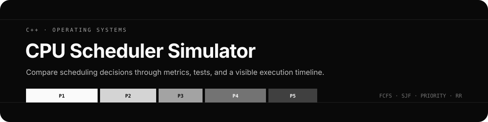
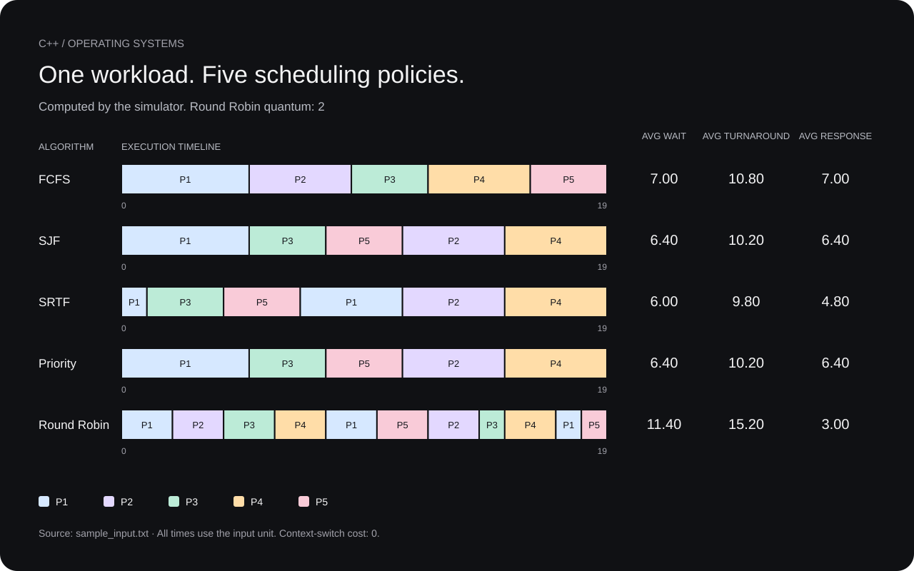

<p align="center">
  
</p>

<p align="center">
  <a href="https://github.com/MerveilleDivine/cpu-scheduler-simulator/actions/workflows/cpp-ci.yml">
    
  </a>
</p>

# CPU Scheduler Simulator

I built this C++ simulator to compare CPU scheduling algorithms on the same workload. It reports each process's waiting, turnaround, and response times, plus an execution timeline. Reports are available as terminal text or JSON.

## Build and run

Requirements: a C++11 compiler and CMake 3.20 or newer for the commands below. Python 3 enables the CLI regression suite.

### Linux and macOS

```bash
cmake -S . -B build
cmake --build build --config Release
ctest --test-dir build -C Release --output-on-failure
./build/scheduler -f examples/sample_input.txt --compare --quantum 2
```

### Windows

With CMake and the Visual Studio C++ build tools installed, run in PowerShell:

```powershell
cmake -S . -B build
cmake --build build --config Release
ctest --test-dir build -C Release --output-on-failure
.\build\Release\scheduler.exe -f examples/sample_input.txt --compare --quantum 2
```

The executable path depends on the CMake generator. With Ninja, use `.\build\scheduler.exe`. The C++ tests run without Python; CMake adds the CLI tests when Python 3 is available. Bash is only used for an additional smoke test on Unix.

### Compile directly

```bash
g++ -std=c++11 -Wall -Wextra -Wpedantic src/main.cpp src/Parser.cpp src/Scheduler.cpp src/Reporter.cpp -Iinclude -o scheduler
./scheduler -f examples/sample_input.txt --algorithm fcfs
```

The remaining examples use the CMake executable path for Linux and macOS.

## Algorithms

| Option | Model | Selection rule |
|---|---|---|
| `fcfs` | Non-preemptive | Earliest arrival |
| `sjf` | Non-preemptive | Shortest burst among ready processes |
| `srtf` | Preemptive | Shortest remaining burst among ready processes |
| `priority` | Non-preemptive | Lowest priority number among ready processes |
| `rr` | Preemptive | Ready queue, with a fixed time quantum |
| `none` | File-order baseline | Run processes in their input order |

Ties in SJF, SRTF, and Priority are resolved by arrival time, then process ID. FCFS and Round Robin use arrival time, then ID for initial queue order. IDs follow the order of valid process lines in the input file.

In Round Robin, processes arriving during a time slice, including at its end, enter the queue before the running process is requeued. In `none` mode, the CPU waits for the next listed process to arrive even if another process is ready.

SJF, SRTF, and Priority keep ready processes in heaps. SRTF advances to arrivals and completions instead of stepping through every time unit. Round Robin skips repeated slices when no other process is ready.

## Input

Each process occupies one line:

```text
burst_time:arrival_time:priority
```

The sample in `examples/sample_input.txt` contains:

```text
5:0:3
4:1:2
3:1:1
4:2:2
3:3:1
```

Fields must be integers. Burst time must be positive, arrival time must be nonnegative, and priority can be any signed integer. A lower number means higher priority. Blank lines, spaces around fields, and comments starting with `#` are supported:

```text
# burst : arrival : priority
5 : 0 : 3  # P1
4 : 1 : 2  # P2
```

An invalid field reports its line number. An empty workload is rejected.

## Usage

Run one algorithm:

```bash
./build/scheduler -f examples/sample_input.txt --algorithm srtf
./build/scheduler -f examples/sample_input.txt --algorithm rr --quantum 2
```

Compare FCFS, SJF, SRTF, Priority, and Round Robin:

```bash
./build/scheduler -f examples/sample_input.txt --compare --quantum 2
```

Write JSON to a file:

```bash
./build/scheduler -f examples/sample_input.txt --algorithm srtf --format json -o schedule.json
./build/scheduler -f examples/sample_input.txt --compare --quantum 2 --format json -o comparison.json
```

The report is also printed to the terminal when `-o` is supplied. A single-algorithm JSON report includes `algorithm`, `averages`, `processes`, and `timeline`. Idle intervals have a `null` process ID. Comparison JSON contains an `algorithms` array of average metrics.

| Option | Purpose |
|---|---|
| `-f`, `--input` | Process input file |
| `-a`, `--algorithm` | One algorithm from the table above |
| `--compare` | Compare the five scheduling algorithms |
| `-q`, `--quantum` | Positive integer time slice for Round Robin |
| `--format` | `text` (default) or `json` |
| `-o`, `--output` | Save a copy of the report |
| `-h`, `--help` | Show usage |

`--compare` and `--algorithm` cannot be combined. If the input file, algorithm, or required quantum is omitted, the program prompts for it.

## Sample results

With the included workload and a Round Robin quantum of `2`:



Each bar shows when a process actually runs. SRTF interrupts P1 when a shorter job arrives; Round Robin shares the CPU in two-unit slices. The diagram and its averages come from the executable's JSON output. To regenerate it after building:

```bash
python3 tools/render_timelines.py ./build/scheduler examples/sample_input.txt --quantum 2
```

| Algorithm | Average waiting | Average turnaround | Average response |
|---|---:|---:|---:|
| FCFS | 7.00 | 10.80 | 7.00 |
| SJF | 6.40 | 10.20 | 6.40 |
| SRTF | 6.00 | 9.80 | 4.80 |
| Priority | 6.40 | 10.20 | 6.40 |
| Round Robin | 11.40 | 15.20 | 3.00 |

Times use the same unit as the input; text reports label them as milliseconds. For each process:

- Turnaround time = completion time − arrival time.
- Waiting time = turnaround time − burst time.
- Response time = first start time − arrival time.

Round Robin gives a faster first response on this workload, while SRTF gives the lowest average waiting time. These results depend on the workload and the quantum.

## Tests

Run the tests through CTest:

```bash
ctest --test-dir build -C Release --output-on-failure
```

To run the CLI suite directly:

```bash
python3 tests/validate_json.py ./build/scheduler examples/sample_input.txt
```

The tests cover scheduling order, preemption, idle intervals, metrics, input validation, JSON reports, comparison mode, and file output. The Python suite checks 636 schedules against an independent implementation that advances one time unit at a time, then checks large timestamps and CLI errors. GitHub Actions is configured to build and test on Ubuntu and Windows, with AddressSanitizer and UndefinedBehaviorSanitizer checks on Ubuntu.

## Code layout

| Path | Responsibility |
|---|---|
| `include/Process.h` | Process data, timeline segments, and schedule results |
| `src/Parser.cpp` | Read and validate process files |
| `src/Scheduler.cpp` | Scheduling rules and metric calculations |
| `src/Reporter.cpp` | Text and JSON output |
| `src/main.cpp` | CLI arguments and interactive prompts |
| `tests/` | C++ tests and CLI regression checks |
| `tools/render_timelines.py` | Generate the sample SVG from executable JSON reports |

## Scope and limits

The model has one CPU and one CPU burst per process. Context switches take no time. It does not model I/O, multiple cores, priority aging, or preemptive Priority scheduling.

Input fields and simulated timestamps use C++ `int`. A run is rejected if its timeline would exceed `std::numeric_limits<int>::max()` (normally 2,147,483,647). Small Round Robin quanta can produce large timelines when several long processes share the CPU.
